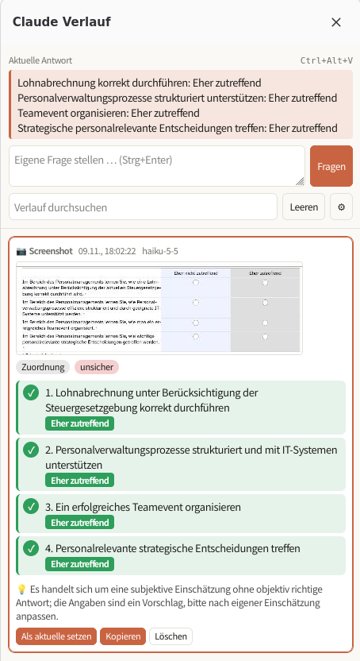

# Quick Answer for Claude

Firefox-Erweiterung, die markierten Text oder einen Bildschirmausschnitt an Claude schickt und eine kurze, übersichtliche Antwort zurückgibt. Die Antwort lässt sich per Tastenkürzel direkt in ein Formularfeld einfügen. Alle Fragen und Antworten landen in einer Sidebar als Verlauf.

<p align="center">
  
</p>

## Funktionen

- **Text fragen:** Text markieren und Kürzel drücken (oder Rechtsklick → „Claude fragen“).
- **Screenshot fragen:** Bereich mit der Maus aufziehen. Claude liest die Frage aus dem Bild.
- **Übersichtliche Antworten:** Claude antwortet strukturiert, und die Antwort wird je nach Fragetyp dargestellt:

  | Fragetyp | Darstellung |
  |---|---|
  | Zuordnung (zutreffend/nicht zutreffend, richtig/falsch …) | eine Zeile pro Aussage, grün ✓ oder rot ✗, mit der Spaltenbezeichnung von der Seite |
  | Single-/Multiple-Choice | alle Optionen; richtige hervorgehoben, falsche abgeschwächt |
  | Rechenaufgabe | Ergebnis gross, Rechenweg als kurze Notiz |
  | Offene Frage | Antwort in 1–3 Sätzen |

  Dazu zeigt jede Antwort an, wie sicher sich Claude ist (sicher / eher sicher / unsicher), und gibt höchstens einen Satz Begründung.
- **Einfügen per Tastenkürzel:** in normale Eingabefelder, Textfelder und Rich-Text-Editoren, auch in iframes und auf Seiten mit React oder Vue. Ist kein Feld fokussiert, wird die Antwort in die Zwischenablage kopiert.
- **Verlauf in der Sidebar:** durchsuchen, kopieren, löschen, eigene Fragen eintippen, auch mit einem per Strg+V eingefügten Bild aus der Zwischenablage. Mit „Als aktuelle setzen“ wird eine frühere Antwort wieder zur Antwort für das Einfüge-Kürzel.
- **Popup auf der Seite:** zeigt kurz den Status und die Antwort an. Es bleibt stehen, solange die Maus darüber ist, und lässt sich abschalten.
- **Microsoft-Forms-Modus:** liest alle Fragen der aktuellen Formularseite aus (Single-/Multiple-Choice, Bewertung, Likert-Matrix, Dropdown, Text, Zahl, Datum, inkl. Bilder), lässt sie in einem Durchgang von Claude beantworten und füllt die Antworten direkt ein. Unsichere Antworten werden auf der Seite gestrichelt markiert (gelb = eher sicher, rot = unsicher). Auf „Weiter“ bzw. „Absenden“ klickst du selbst; danach auf der nächsten Seite einfach wieder das Kürzel drücken. Jede Seite landet als kompakte Liste (Frage → Antwort) im Verlauf. Rangfolge- und Datei-Upload-Fragen werden übersprungen.
- **Eigene Tastenkürzel:** direkt in den Einstellungen festlegen.

## Installation

Voraussetzungen: Firefox 140 oder neuer und ein API-Key von der [Claude Console](https://platform.claude.com/).

### Zum Ausprobieren (temporär)

1. `about:debugging#/runtime/this-firefox` öffnen.
2. **Temporäres Add-on laden …** klicken und die Datei `manifest.json` aus diesem Ordner wählen.

Temporäre Add-ons verschwinden beim Neustart von Firefox. Nach Änderungen am Code dort auf **Neu laden** klicken und offene Tabs neu laden.

### Dauerhaft

Normale Firefox-Versionen installieren nur signierte Erweiterungen. Es gibt zwei Wege:

- **Signieren lassen (empfohlen):** Mit einem kostenlosen Konto auf [addons.mozilla.org](https://addons.mozilla.org/developers/) als „unlisted“ einreichen. Das geht automatisch und die Erweiterung wird nicht öffentlich:

  ```bash
  nix shell nixpkgs#nodejs -c npx web-ext sign --channel unlisted \
    --api-key "$AMO_JWT_ISSUER" --api-secret "$AMO_JWT_SECRET"
  ```

  Die signierte `.xpi` liegt danach in `web-ext-artifacts/` und lässt sich per Drag & Drop in Firefox installieren.

- **Ohne Signatur:** Nur mit Firefox Developer Edition, Nightly oder ESR möglich, wenn dort in `about:config` `xpinstall.signatures.required` auf `false` steht. Dann packen und installieren:

  ```bash
  zip -r ../quick-answer-for-claude.xpi . -x 'docs/*' 'README.md' '.git/*' 'web-ext-artifacts/*'
  ```

## Einrichtung

1. Einstellungen öffnen: `about:addons` → Quick Answer for Claude → **Einstellungen**. Die Seite öffnet sich auch automatisch, wenn beim ersten Benutzen noch kein API-Key gesetzt ist.
2. API-Key eintragen, **Verbindung testen** und **Speichern** klicken.
3. Optional Modell, Denktiefe, System-Prompt und Tastenkürzel anpassen.

| Einstellung | Standard | Hinweis |
|---|---|---|
| Modell | Claude Opus 5.5 | Sonnet 5.5 ist schneller und günstiger, Haiku 5.5 am schnellsten. |
| Denktiefe (`effort`) | `low` | `medium` oder `high` für knifflige Rechen- und Logikaufgaben, dauert aber länger. |
| System-Prompt | kurz und präzise antworten | Die Anweisungen für das Antwortformat werden automatisch angehängt. |
| Popup auf der Seite | an | |
| Max. Einträge im Verlauf | 200 | Ältere Einträge werden automatisch gelöscht. |

## Bedienung

| Standard-Kürzel | Aktion |
|---|---|
| `Ctrl+Alt+A` | Markierten Text an Claude schicken |
| `Ctrl+Alt+S` | Bereich aufziehen und als Screenshot schicken · `Enter` = ganzer sichtbarer Bereich · `Esc` = Abbruch |
| `Ctrl+Alt+V` | Aktuelle Antwort ins fokussierte Feld einfügen |
| `Ctrl+Alt+F` | Microsoft-Forms-Seite ausfüllen lassen (auch per Rechtsklick → „Formular von Claude ausfüllen lassen“) |
| `Ctrl+Alt+H` | Sidebar mit dem Verlauf ein-/ausblenden |

Alle Aktionen gibt es auch im Rechtsklick-Menü.

**Kürzel ändern:** In den Einstellungen unter **Tastenkürzel** ins Feld klicken und die neue Kombination drücken. `Backspace` entfernt ein Kürzel, **↺** stellt den Standard wieder her. Doppelte Belegungen werden abgelehnt, bei bekannten Firefox-Kürzeln erscheint eine Warnung.

`Ctrl+Alt` ist als Standard gewählt, weil Firefox damit kaum etwas belegt hat (Ausnahme: `Ctrl+Alt+R` für den Lesemodus) und Fenstermanager wie Hyprland meist `Super` nutzen. Unter Linux ist AltGr eine eigene Taste, deshalb gibt es auch mit Schweizer oder deutschem Layout keine Konflikte mit `@`, `#` oder `€`. Meiden solltest du `Ctrl+Alt+F1`–`F12`, das wechselt auf die Textkonsole.

**Bei Zuordnungs- und Auswahlfragen** fügt `Ctrl+Alt+V` eine kurze Zusammenfassung als Text ein (z. B. „1. Eher zutreffend …“). Radio-Buttons und Checkboxen musst du selbst anklicken.

## Datenschutz

- API-Key, Einstellungen und Verlauf liegen nur lokal im Firefox-Profil (`browser.storage.local`) und werden nicht synchronisiert.
- Gesendet wird nur, was du aktiv auslöst: der markierte Text oder der gewählte Ausschnitt. Ziel ist ausschliesslich `api.anthropic.com`.
- Im Verlauf werden Screenshots nur als kleine Vorschaubilder gespeichert.

## Projektstruktur

```
manifest.json        Manifest (MV2): Berechtigungen, Kürzel, Sidebar, Einstellungsseite
background.js        API-Aufrufe, Screenshots zuschneiden, Verlauf, Kürzel und Rechtsklick-Menü
content.js           Bereichsauswahl, Einfügen in Formularfelder, Popup auf der Seite
render.js            Gemeinsame Darstellung der Antworten (Popup und Sidebar)
sidebar/             Verlauf-Sidebar
options/             Einstellungsseite inkl. Kürzel-Editor
icons/               Symbole (icon.svg = Vorlage, PNGs in 16–128 px)
docs/                Bilder für dieses README
```

## Technische Details

- **Kein Build-Schritt, keine Abhängigkeiten.** Reines JavaScript mit der WebExtension-API. Manifest V2, das Firefox weiterhin unterstützt. Weil es keinen Bundler gibt, wird die API direkt per `fetch` angesprochen statt über das Anthropic SDK.
- **API:** `POST https://api.anthropic.com/v1/messages` mit dem Header `anthropic-dangerous-direct-browser-access: true`, der für Anfragen aus dem Browser nötig ist.
- **Strukturierte Antworten:** Über `output_config.format` (JSON-Schema) liefert Claude immer die Felder `kind`, `items`, `answer`, `note` und `confidence`. `answer` ist der Text, der eingefügt wird.
- **Fallback:** Bei Opus und Sonnet ist der serverseitige Fallback (`fallbacks: "default"`) aktiv. Lehnt ein Sicherheitsfilter eine harmlose Anfrage fälschlich ab, wiederholt die API sie automatisch auf einem anderen Modell.
- **Screenshots:** `tabs.captureVisibleTab` nimmt den sichtbaren Bereich auf, danach wird er passend zu `devicePixelRatio` zugeschnitten. Grosse Bilder werden verkleinert bzw. als JPEG gesendet.

Prüfen:

```bash
nix shell nixpkgs#nodejs -c npx web-ext lint
```

## Hinweis

Nutze die Erweiterung nur dort, wo KI-Hilfsmittel erlaubt sind, zum Beispiel bei Open-Book-Prüfungen, Übungstests oder zum Lernen. Claudes Antworten können falsch sein, besonders wenn sie als „unsicher“ markiert sind.
